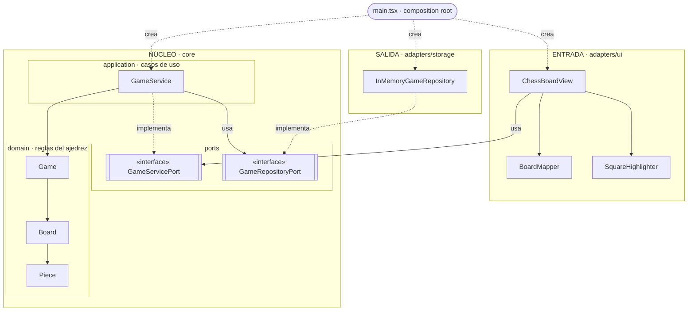
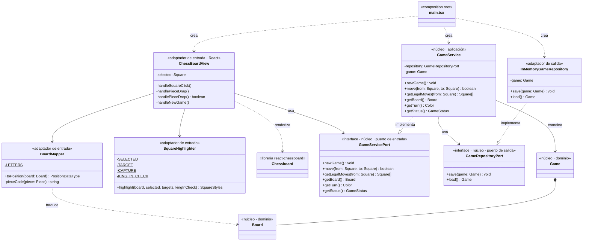
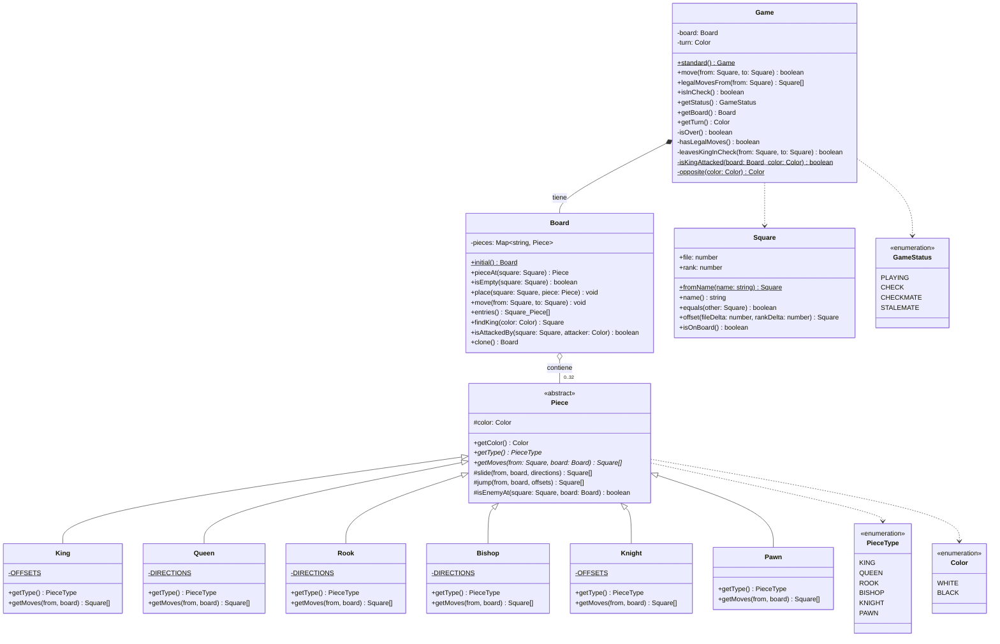

# Diagrama de clases — Arquitectura hexagonal

## 1. Vista general

Quién conoce a quién. Todas las flechas de dependencia apuntan **hacia el núcleo**.

El **núcleo** tiene tres partes, todas dentro de `src/core/`:

| Parte | Qué hace | Puede importar de |
| --- | --- | --- |
| `core/domain` | Las reglas del ajedrez: piezas, tablero, jaque, mate | nada |
| `core/ports` | Las interfaces que forman el borde del hexágono | `domain` |
| `core/application` | `GameService`: coordina los casos de uso (mover, nueva partida) usando el dominio y los puertos | `ports` y `domain` |

Afuera del núcleo:

| Parte | Qué hace | Puede importar de |
| --- | --- | --- |
| `adapters/*` | Lo técnico: React, la librería del tablero, el almacenamiento | `core` (nunca al revés, ni entre adaptadores) |
| `main.tsx` | Crea todas las clases concretas y las conecta | todo |

Al ejecutar, el orden de las llamadas es UI → `GameService` → repositorio. Pero en el código **el repositorio depende del núcleo**, porque implementa la interfaz `GameRepositoryPort` que el núcleo define. Eso es la inversión de dependencias.

## 2. Clases de la arquitectura

Puertos, servicio y adaptadores. El estereotipo de cada clase (`«...»`) dice en qué parte del hexágono vive. Del dominio solo se muestran `Game` y `Board`, que es donde se conectan; el detalle está en la sección 3.

## 3. Clases del dominio

Las reglas del ajedrez. No conocen ni los puertos, ni los adaptadores, ni React.

## Cómo leer las flechas

| Flecha | Significa | Ejemplo |
| --- | --- | --- |
| Línea llena con triángulo | Herencia: "es un" | `King` es una `Piece` |
| Punteada con triángulo | Implementa una interfaz | `GameService` implementa `GameServicePort` |
| Rombo lleno | Composición: la parte no existe sin el todo | `Game` tiene un `Board` |
| Rombo vacío | Agregación: contiene, pero las partes existen solas | `Board` contiene `Piece` |
| Línea llena con flecha | Asociación: guarda una referencia y la usa | `GameService` usa `GameRepositoryPort` |
| Punteada con flecha | Dependencia: la usa o la crea, sin guardarla | `main.tsx` crea `GameService` |

## Notas

- `Square` y `Color` se usan en casi todas las clases. Para no llenar el diagrama de flechas, solo se dibujan las dependencias más importantes.
- `ChessBoardView` es una función, porque React exige funciones para usar hooks. Se dibuja como clase para mostrar su rol de adaptador. `main.tsx` es el script de arranque.
- `Board.entries()` devuelve `[Square, Piece][]`. En el diagrama figura como `Square_Piece[]` porque Mermaid no acepta tuplas.
- `pieceAt()` y `findKing()` pueden devolver `undefined`, y `load()` puede devolver `null`.
